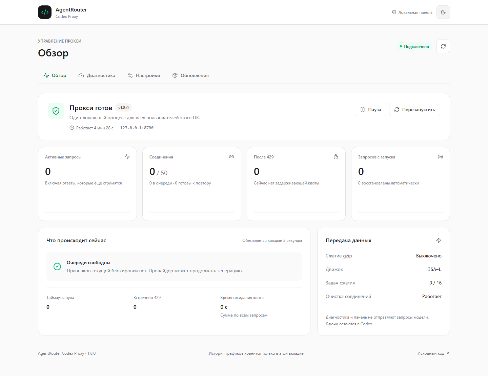

# Browser control and validation: 1.8.0

Open **http://127.0.0.1:8788/** for overview, diagnostics, 23 tuning settings and updates. Routine pause/resume, graceful restart, temporary profiling and report export are available in the browser. Compatible package installation requires the prepared shared service; see the [Windows installation guide](windows-installation.md) and [Russian quick guide](browser-control.ru.md).



The screenshot uses the disposable test port 8790. The normal installation uses 8788.

## Changes

- Full-lifetime API accounting includes responses that are still streaming. Pausing refuses new API calls while current streams continue.
- Restart drains current requests, applies separately saved tuning values and reconnects the panel. Immediate interruption requires an explicit force choice.
- Settings reject stale revisions from another tab. Keys, Codex configuration and conversation history are preserved.
- Browser updates verify four successful CI jobs for the selected commit, bounded package contents, unchanged dependency pins/bootstrap, prepared hashes and isolated startup/API/assets behavior. Verified backups and an immutable bootstrap support rollback after copy, startup or health-check failure.
- One Responses receive owner spans retries, sends and partial response-body reads, then is joined before Starlette owns the stream. This removes 350 ms upstream polling and a Python 3.10 cancellation race. Compression policy and supported HTTPcore 1.0.9 remain unchanged.
- The panel bundles its assets, has light/dark and mobile layouts, slows or pauses status polling in hidden tabs, and checks GitHub only on request. Reports omit keys, prompts, provider details, raw logs and local paths.

## Local comparison with 1.7.0

Two running servers alternated adjacent baseline/candidate request pairs (AB/BA), with shuffled scenarios, warmup and identical pinned native packages. Two epochs of 90 pairs for each of six scenarios produced **1,080 pairs**. Decoded bodies were hash-checked by a synthetic upstream. No provider/model requests were made.

All times below are milliseconds to the first output SSE event on the whole loopback path, including synthetic validation. The last column is the median per-pair saving and its percentile-bootstrap 95% interval, rather than the difference of aggregate medians.

| Scenario | 1.7 median | 1.8 median | 1.7 p95 | 1.8 p95 | Paired saving [95% interval] |
| --- | ---: | ---: | ---: | ---: | ---: |
| Short request | 5.646 | 5.479 | 12.521 | 13.788 | 0.244 [0.162, 0.308] |
| English history | 10.673 | 10.430 | 23.563 | 28.158 | 0.246 [0.058, 0.347] |
| Russian history | 14.931 | 14.779 | 34.687 | 33.719 | 0.297 [0.046, 0.554] |
| Tool history | 14.665 | 14.018 | 33.852 | 32.013 | 0.333 [0.108, 0.531] |
| Tool history / gzip rejection | 13.653 | 13.039 | 31.669 | 34.743 | 0.460 [0.314, 0.717] |
| Thirty images | 32.531 | 32.118 | 66.091 | 73.582 | 0.126 [-0.584, 0.863] |

Healthy medians are comparable and slightly lower in this run. Tail latency is mixed, and the images interval crosses zero; this does not prove a speedup for every request or better p95. Samples may have serial correlation and Windows background load changes absolute results. Model generation and Internet/provider response time were not measured.

## Disconnect cleanup

Each variant received **42 real TCP samples**, with a cached request body and an upstream withholding response headers. Clients disconnected at offsets from 0 to 300 ms. Each sample verified that the upstream socket and pool capacity were released and no pending HTTPcore request remained.

| Metric | 1.7.0 | 1.8.0 |
| --- | ---: | ---: |
| Median release delay | 196.033 ms | 0.627 ms |
| p95 release delay | 351.810 ms | 0.698 ms |

This improves how quickly a cancelled request releases local capacity, especially when other requests are queued. It is a controlled loopback result, not a guarantee of Internet socket-close latency or faster model generation.

## Validation

**154/154 tests passed** under Python 3.10.11 and two Python 3.12.6 installations, including the shared portable runtime. All 15 frozen runtime hashes were checked before and after. Pinned packages included HTTPX 0.28.1, HTTPcore 1.0.9, FastAPI 0.115.6, ISA-L 1.9.1 and httptools 0.9.0.

A **901.1-second** real TCP endurance run completed **2,416 successful calls** and **1,366 expected cancellations** with zero unexpected errors. It exercised slow readers, bounded compression bursts, profiling, 429, 415, resource mismatches and intentional resets. No model/provider requests were made.

Four disposable Windows supervisor scenarios passed: browser prepare/install/reconnect, early worker exit rollback, cold supervisor import rollback and health-timeout rollback. Environment/settings bytes were preserved and final worker health checked. Browser smoke checks covered light/dark, all mobile sections, profile/report, settings save/apply/restore across restart, pause confirmation/cancellation and API gating. No external browser requests occurred.

Nine installer simulations checked preflight drift/collisions, explicit allowlists, verified backups, copy/permission/probe/staging failures and rollback failure. They mock OS/HTTP/ACL boundaries and do not establish real LOCAL SERVICE permissions; those require verification after an administrator installation.

## Reproduce

From a full clone with the pinned Python requirements installed:

```powershell
python benchmarks/compare.py --baseline-ref 80cb7f48827dfb60675faac0dfc5cefc7b34a40b --samples 90 --epochs 2
python benchmarks/cancellation.py --source .\proxy.py --samples 42 --output cancellation-current.json
python -m unittest discover -s tests -v
npm ci --prefix panel-src --no-audit --no-fund
npm run build --prefix panel-src
```

Use a separate complete baseline runtime for the baseline cancellation run. The scripts preserve existing result files/directories. [Sanitized measurements and exact runtime hashes](assets/browser-control-1.8.0-data.json) accompany this report. Earlier failed timing fixtures and rejected compression experiments are retained privately; the published results describe the selected frozen runtime only.
