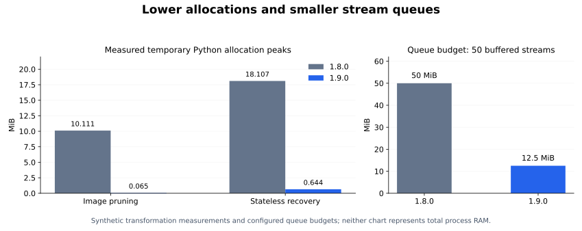

# Memory, history and independent control: 1.9.0

Open **http://127.0.0.1:8789/** when running `service.py` or the protected machine service. The supervisor owns this independent panel; Codex continues using **http://127.0.0.1:8788/v1**. The worker also retains its original panel on 8788. See the [Windows installation guide](windows-installation.md) or the [Russian quick guide](browser-control.ru.md).

## Changes

- Russian/English navigation, settings, errors and confirmation dialogs. Language and number/date formatting are remembered per browser.
- Retained request metadata, outcome filters and cursor pages of 50 records. Daily memory/queue charts render at most 120 points.
- Independent management, offline history and confirmed recovery while the worker is unresponsive. API traffic has no additional forwarding hop.
- A one-minute diagnostic capture after three final errors within a minute, with five-minute cooldown and up to 16 saved reports.
- Smaller SSE queues, copy-on-write payload transformations, a lightweight supervisor and cached native memory bindings.

## What is recorded

History contains an opaque request key, worker PID, start time, fixed endpoint label, HTTP method/status, outcome, full duration, header latency, byte counts and quota/admission/preparation intervals. It excludes prompt/output text, headers, credentials and URL/query details.

A small start record is committed asynchronously, then updated at completion. Accepted starts reserve capacity for their completion within the same fixed queue budget. An overload can skip new starts or standalone metadata, but cannot consume an accepted start's completion capacity. The background writer coalesces arrivals in a soft 10 ms window, up to 128 operations per transaction; API enqueue never waits for this window or for a disk commit. After a worker exits, retained active calls become `interrupted / worker_restarted`; a crash can leave byte counts and headers unknown. Request duration includes the full response stream and cleanup. Timing stages can overlap and should not be summed as proxy CPU time.

History survives restarts and is shared by users of that proxy instance. Clearing it requires confirmation and preserves Codex chats. Disabled recording leaves previously saved records readable. A crash before an asynchronous commit can lose the most recent records. A slow/full disk drops bounded telemetry work instead of waiting on the API path; dropped/write-error counters are available in status.

## Resource bounds

| Resource | Default or cap |
| --- | ---: |
| SSE queue payload per stream | 256 KiB, previously 1 MiB |
| SSE outcome inspection | At most 192 bytes of the current line |
| Worker history queue and reserved completions | 256 combined credits |
| Supervisor history queue | 64 operations |
| Writer's current transaction batch | Up to 128 operations, separate from pending queue credits |
| Retained requests | 2000 over 24 hours; configurable up to 10000 over 168 hours |
| Metric samples | Up to 1440 |
| Recovery events | Up to 256 retained, 50 per response |
| Automatic reports | Up to 16, each at most 64 KiB |
| SQLite writer/reader caches | 512 / 256 KiB per connection, mmap disabled |
| Database pages | 8192, approximately 32 MiB with default 4 KiB pages |
| Independent HTTP handlers | 6, backlog 8 |
| Asset read chunks | 64 KiB |
| Browser request page / graph | 50 records / 120 points |

WAL autocheckpoint is 256 pages, with a 1 MiB journal-size target and periodic truncate checkpoints. Active readers can prevent truncation, so this is not a strict WAL-file cap. An overloaded independent listener returns 503 where possible or closes the rejected connection, without allocating more handlers.

Queue payload limits are separate from process RSS. Request bodies, parsed JSON, in-flight priming/producer pieces, HTTP/socket buffers, Python, the supervisor and the browser use additional memory. At 50 fully buffered streams, queue payload budgets total 12.5 MiB rather than 50 MiB. Existing explicit `.env` or saved browser budgets remain in force; choose 262144 in **Settings → Streaming** to lower an older 1048576 override.

The supervisor imports Starlette's small request/response helpers and loads FastAPI's router only in the worker. This avoids retaining FastAPI/Pydantic in the management process. Windows memory measurements reuse one native structure/pointer binding, rather than retaining a new ctypes type for every sample.

## Recovery policy

The monitor checks the owned worker locally. A responsive health endpoint prevents a hang diagnosis even if status cannot be read. Long provider responses and quota waits do not cause recovery while the worker remains responsive.

Automatic recovery needs three failed checks spaced ten seconds apart, a thirty-second startup grace, no managed update in progress and fewer than three automatic recoveries within ten minutes. A manual recovery requires confirmation and targets the supervisor's current worker PID. It interrupts unfinished calls, which can be retried in Codex. The panel and retained history remain available. After ten rapid worker exits, the supervisor keeps the panel alive for manual recovery.

The independent panel requires an available loopback port, defaulting to the worker port plus one. Override `PROXY_PANEL_PORT` in `.env` if needed. An occupied listener is left untouched; the service logs the unavailable panel, and automatic hang recovery is not enabled. If the entire supervisor is stopped, use Windows task startup from the installation guide.

## Reproduce the memory comparison

From a full checkout with `requirements.txt` installed:

```powershell
git worktree add --detach ..\proxy-1.8.0 333078e452a21ca951e201b1c51bf1f43ac0bad1
python benchmarks/memory.py --baseline ..\proxy-1.8.0\proxy.py --candidate proxy.py --output memory-comparison.json --samples 15
```

The benchmark uses isolated credential-free workers and identical synthetic fixtures: 2000 messages with nested metadata plus 150 images. Input and transformed-output hashes must match between variants. It reports Python allocation peaks inside transformation, excluding fixture construction, JSON decoding/encoding and API traffic. These reductions are workload-specific and do not mean total RSS falls by the same percentage.

For adjacent loopback latency pairs against 1.8.0:

```powershell
python benchmarks/compare.py --baseline-ref 333078e452a21ca951e201b1c51bf1f43ac0bad1 --samples 90 --epochs 2
```

Both versions use the same pinned native dependencies, warmup, synthetic fixtures and decoded-body hash checks. The test alternates baseline/candidate ordering and measures the whole loopback path to first output SSE delivery. It makes no provider calls and preserves existing result folders.

## Measured results and validation



| Synthetic transformation | 1.8.0 peak bytes | 1.9.0 peak bytes | Reduction |
| --- | ---: | ---: | ---: |
| Image pruning | 10,601,696 | 68,516 | 99.35% |
| Stateless recovery | 18,986,176 | 675,065 | 96.44% |

These are medians of 15 Python allocation-peak samples for each case, with matching input/output hashes. They exclude decoding, encoding, network traffic and most process memory. The 50-stream comparison is a configured payload-queue budget, not a measured RSS reduction.

Loopback first-output delivery, milliseconds; 180 adjacent AB/BA pairs per scenario:

| Scenario | 1.8.0 median | 1.9.0 median | 1.8.0 p95 | 1.9.0 p95 |
| --- | ---: | ---: | ---: | ---: |
| Small input | 4.666 | 4.678 | 6.721 | 7.228 |
| English history | 9.136 | 9.181 | 20.239 | 19.562 |
| Russian history | 13.298 | 12.870 | 24.407 | 23.565 |
| Tool history | 12.846 | 12.614 | 27.935 | 26.860 |
| Tool history, gzip rejection | 11.908 | 11.815 | 23.683 | 22.716 |
| 30 images | 28.126 | 27.627 | 42.762 | 43.042 |

Median differences are at most 0.499 ms in this run. 5 of 6 paired-median bootstrap intervals include zero; p95 varies more. The table describes these loopback fixtures, not a general speedup or a guarantee of zero overhead. Provider generation and internet latency are excluded. Bootstrap samples can have serial correlation.

The final snapshot passed 197 tests with zero failures/errors/skips in portable Python 3.12.6, local Python 3.12.6 and Python 3.10.11. The real Windows supervisor/browser test verified RU/English, mobile layouts, saved settings, offline history, automatic reports, and automatic/manual recovery. An owned suspended worker recovered in 29.69 s; manual browser recovery took 8.95 s. A responsive 42.55 s provider stream did not trigger recovery.

Four real managed-update scenarios passed: success, early worker exit rollback, cold supervisor import rollback, and health timeout rollback. They preserved configuration and saved settings.

A separate 15-minute synthetic workload completed 9,356 successful calls and 5,382 expected cancellations, with zero unexpected errors and all stream/pool/quota/compression references idle at completion. Peak worker RSS was 137.2 MiB under this workload. This short run does not prove indefinite leak freedom or bound RSS for arbitrary request bodies.

The retained history database passed its integrity check and row/page bounds, with zero active records after all handlers finished. An additional one-minute test injected cancellation/compression bursts every cycle and also ended with zero unfinished handlers, queued history work or active history records. Its 4,632 dropped metadata operations demonstrate bounded best-effort recording under overload; accepted starts kept their reserved completion capacity.

Allowlisted raw data: [memory](evidence/1.9.0/memory.json), [latency and paired intervals](evidence/1.9.0/latency.json), and [validation with source hashes](evidence/1.9.0/validation.json). The validation manifest includes both tested Windows byte hashes and LF-normalized Git hashes. Local paths, credential/configuration hashes and private machine state are excluded.
