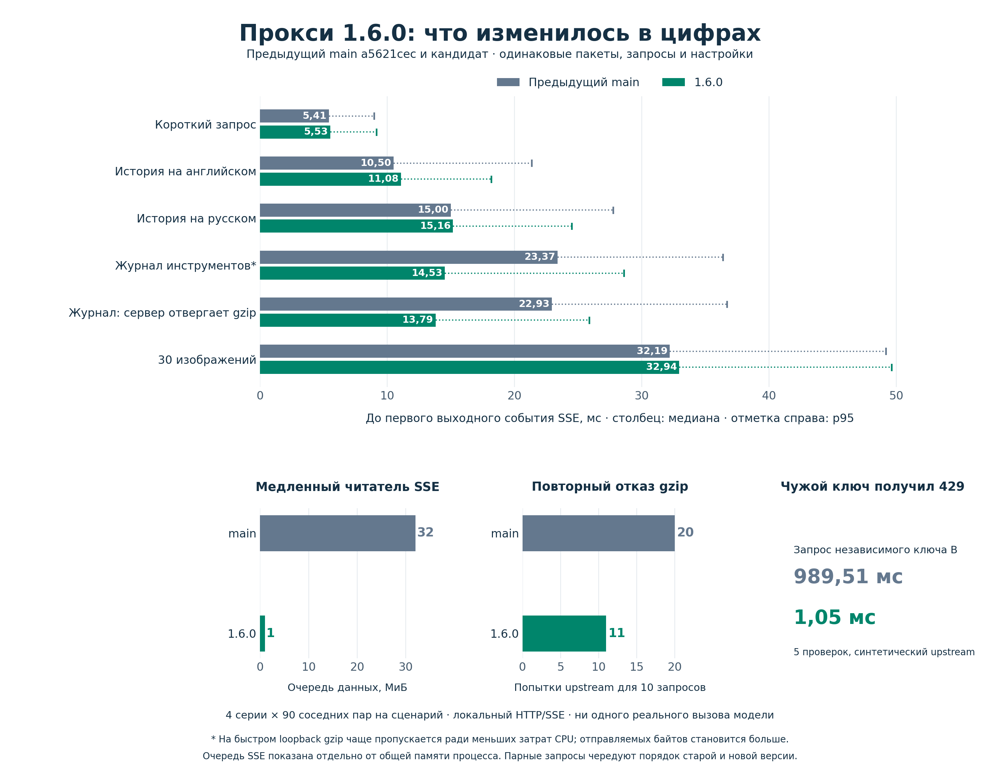
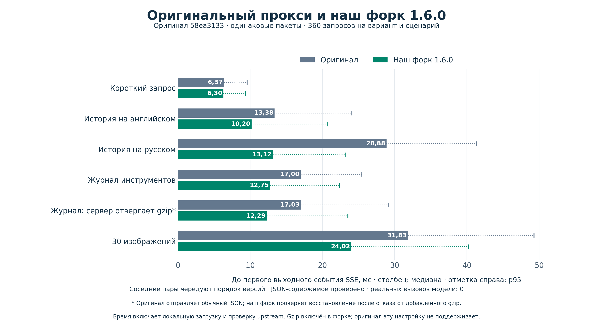
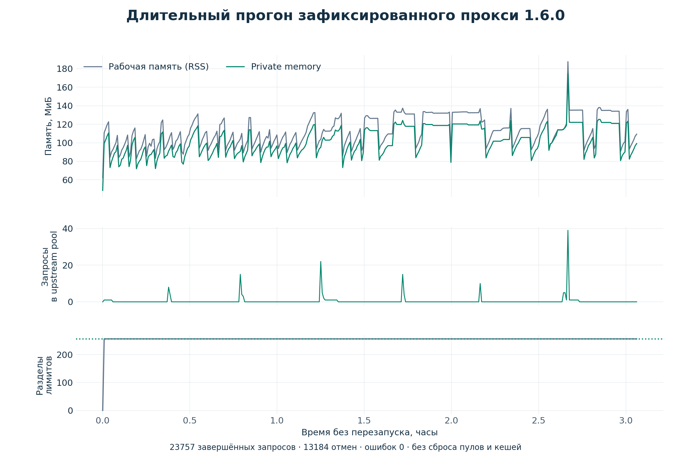

# Runtime settings and measured results

Version 1.9.0 adds [independent management, bounded history and lower-memory payload transforms](resilience-1.9.0.md). Open the supervisor panel on `http://127.0.0.1:8789/`; API calls still use 8788. Thirty browser settings cover history retention, incident capture and watchdog timing as well as existing transport tuning. The default SSE queue is now 256 KiB; existing explicit `.env` or browser values continue to take precedence.

Version 1.8.0 moves routine management to the [browser panel](browser-control-1.8.0.md): overview, temporary profiling/report export, 23 tuning values, pause/resume, graceful restart and compatible package updates. Browser overrides are saved separately from `.env` and apply after a restart. A receive listener now covers Responses quota waits, sends and body reads, replacing upstream-send polling while preserving the prior compression policy.

Version 1.7.0 adds fair cancellable quota launches, generation-fenced cooldown recovery, elapsed quota waiting and temporary profiling. Use [the diagnostic CLI](diagnostics.md) to watch queues or capture a timing window. PROXY_TIMINGS=0 is the default fast mode; 1 enables persistent capture after restart. Authoritative hints can exceed generated backoff; a request's wait budget never shortens other callers' cooldown.

The 1.6.0 measurements below remain evidence for that earlier release. See the separate [1.7.0 recovery, latency and endurance results](recovery-1.7.0.md).

Version 1.6.0 bounds slow-client buffering and compression work, separates independent credentials' rate-limit gates, and avoids repeatedly compressing requests rejected with HTTP 415. These changes preserve the decoded request body and immediate small-chunk delivery. Image pruning and stateless recovery continue to modify payloads only when their existing rules require it.

A client can leave before the upstream sends response headers. Uvicorn does not automatically cancel that pending handler, so an abandoned connection could previously occupy the pool until the read timeout. Version 1.6.0 checked for client disconnect every 350 ms while an upstream send or JSON/error-body read was pending. Version 1.8.0 waits on `http.disconnect` after consuming the request body and joins the receive owner before response handoff. Incomplete-body compatibility callers retain the polling fallback. A response completed during disconnect detection is closed if never handed off. Partial uploads are handled without starting upstream work. Models/listing passthrough requests use the same send/read cleanup.

Upstream admission retains the existing 50-connection limit and each request's pool timeout. Waiters remain outside HTTPcore; an admitted request retains its slot until its response body really closes. A per-pool wrapper also reclaims abandoned CONNECTING or ACTIVE connections with no owning request, under HTTPcore's existing pool lock and cancellation-shielded close. Healthy idle connections and assigned TCP/TLS connections are retained. This wrapper relies on the pinned HTTPcore 1.0.9 internals; dependency upgrades require the real-pool cancellation regressions.

## Defaults

Edit the allowlisted tuning values in the browser's **Settings** section, save and restart. `.env` remains the base configuration; browser overrides are separate. Individual Codex accounts still supply their own credentials.

| Setting | Default | Effect |
| --- | ---: | --- |
| `PROXY_REQUEST_GZIP` | `0` | Opt in to request gzip when the upstream supports it. |
| `PROXY_REQUEST_GZIP_MIN_BYTES` | `262144` | Evaluate gzip only for large request bodies. |
| `PROXY_GZIP_WORKERS` | `4` | Dedicated compression threads, separate from asyncio's default executor. |
| `PROXY_GZIP_MAX_JOBS` | `16` | Maximum submitted running/queued jobs; saturation forwards original bytes. |
| `PROXY_GZIP_REJECT_TTL_S` | `60` | Skip proxy-added gzip briefly for the same upstream/key/project/organization after HTTP 415. `0` disables this hint. |
| `PROXY_GZIP_UPLOAD_MBIT_S` | `0` | Learn a conservative rate hint from real large plain requests; a positive value supplies an explicit Mbit/s rate. |
| `PROXY_GZIP_COST_MARGIN` | `2` | Require estimated upload savings to exceed profiled compression cost by this factor. |
| `PROXY_SSE_BUFFER_BYTES` | `262144` | Queue budget, rounded down to whole 64 KiB pieces, with a minimum of one piece. |
| `PROXY_SSE_PRIME_BYTES` | `262144` | Bound initial SSE inspection; one incoming piece may cross this threshold. |
| `PROXY_SSE_PRIME_FRAMES` | `1024` | Bound allocations for many tiny setup/comment frames. |
| `PROXY_RATE_LIMIT_SCOPE` | `credential` | A 429 pauses callers sharing a key. `shared` coordinates different keys drawing on one quota. |
| `PROXY_RATE_LIMIT_PARTITIONS` | `256` | Maximum cached credential gates; active/cooling gates are protected from eviction. |
| `PROXY_HISTORY_ENABLED` | `1` | Record bounded local metadata; disabling leaves old records readable. |
| `PROXY_HISTORY_MAX_REQUESTS` | `2000` | Retained requests, configurable from 100 to 10000. |
| `PROXY_HISTORY_HOURS` | `24` | Retention window, configurable from 1 to 168 hours. |
| `PROXY_AUTO_DIAGNOSTICS` | `1` | One-minute capture after three final errors within a minute, with five-minute cooldown. |
| `PROXY_WATCHDOG` | `1` | Supervisor recovery of an unresponsive owned worker. |
| `PROXY_WATCHDOG_INTERVAL_S` | `10` | Spacing of failed watchdog checks, from 5 to 60 seconds. |
| `PROXY_WATCHDOG_FAILURES` | `3` | Consecutive failed checks before recovery, from 3 to 12. |

Gzip rejection and upload-hint caches each hold at most 256 entries. Compression cost profiles hold at most 128 entries. Upload/CPU hints expire after 120 seconds; upload estimates require at least two real observations and use the slowest recent sample. Since [1.9.3](gzip-replay-1.9.3.md), observations measure HTTPcore body-write time for successful plain uploads of at least 512 KiB, excluding admission, connection setup and response-header waiting. Socket buffering still limits accuracy; automatic estimates are capped at 1,000 Mbit/s. An unaccounted header wait exceeding both 50 ms and four body-write intervals clears the automatic hint and keeps conservative gzip behavior; this wait is not used as bandwidth. A positive `PROXY_GZIP_UPLOAD_MBIT_S` bypasses the automatic policy. Calibration uses existing requests.

Compression samples three regions before full-body work. A cancelled queued job frees its slot immediately; a running compressor retains its slot until it finishes. Neither case leaks submitted-job capacity. Small payloads and client-supplied encodings bypass this work.

## Useful counters

`/_health` exposes queue/priming limits, quota scope, compression capacity and upstream admission usage. `/_stats` adds:

| Counter | Meaning |
| --- | --- |
| `gzip_busy_skips` | Original bytes forwarded because compression capacity was full. |
| `gzip_cached_rejection_skips` | Skipped a repeated gzip attempt during the scoped HTTP 415 hint. |
| `gzip_cost_skips` | Full-body compression cost was not worthwhile for the available rate hint. |
| `gzip_evaluations` | Completed compression evaluations, including sample/cost skips. |
| `gzip_preparation_seconds_total` | Awaited evaluation time, including queue delay. |
| `sse_backpressure_events` | Producer waited because a streaming queue was full. |
| `sse_prime_buffer_commits` | Initial inspection reached its byte/frame budget and forwarded buffered data. |
| `rate_limit_overflow_requests` | Used the conservative shared overflow gate because protected credential gates filled the cache. |
| `pool_timeouts` | Attempts timed out waiting for an upstream connection/admission slot. |
| `upstream_capacity_waits` | Requests entered the admission wait path. |
| `upstream_orphaned_connections_reclaimed` | Abandoned non-idle/non-closed pool entries reclaimed without an owning request. |
| `upstream_unstarted_connections_reclaimed` | Reclaimed entries that never created their underlying connection. |
| `upstream_disconnect_cancellations` | Abandoned sends or JSON/error reads cancelled after a client disconnect. |
| `client_disconnects_during_upload` | Clients left before the complete request body arrived. |

`gzip_input_bytes` and `gzip_output_bytes` count newly encoded payload versions, excluding retry traffic. A queue budget is not a process-memory limit: request bodies, primed frames, HTTPX, Python and socket buffers consume additional memory.

## Paired loopback measurement

On 2026-11-14, the preceding [main version](https://github.com/zerkavich/agentrouter-codex-proxy/commit/a5621cec2de69050daff58b1a21a76739dbf7e3d) and 1.6.0 ran the same installed package versions, native HTTP parser, ISA-L gzip, minimal logging and synthetic payloads on one Windows PC. Two servers stayed running after warmup. Four epochs collected 90 adjacent baseline/candidate request pairs per scenario, alternating which variant ran first and shuffling scenario order: 360 samples per variant/scenario. Every decoded body was hash-verified at the synthetic upstream. No real model calls were made.

Times include local upload, synthetic upstream validation and delivery of the first output SSE event. They measure the complete loopback path, rather than pure proxy CPU or Internet response time.

| Scenario | Previous median | 1.6.0 median | Previous p95 | 1.6.0 p95 |
| --- | ---: | ---: | ---: | ---: |
| Short request | 5.414 ms | 5.527 ms | 8.960 ms | 9.136 ms |
| Compressible English history | 10.498 ms | 11.083 ms | 21.341 ms | 18.179 ms |
| Compressible Russian history | 14.998 ms | 15.162 ms | 27.757 ms | 24.489 ms |
| Tool-output history | 23.372 ms | 14.528 ms | 36.373 ms | 28.604 ms |
| Tool history, upstream rejects gzip | 22.932 ms | 13.791 ms | 36.677 ms | 25.861 ms |
| Thirty synthetic images | 32.186 ms | 32.936 ms | 49.174 ms | 49.618 ms |

Tool-history median improved by 37.8% and repeated gzip rejection by 39.9%. Other aggregate medians increased by 0.11–0.75 ms. Adjacent-pair medians show a smaller 0.13–0.24 ms overhead for short/healthy English/Russian requests. Background load and sample ordering affect aggregate medians; this run does not establish an improvement for every payload or faster model generation.

The tool-history gain involves a CPU/upload tradeoff: the previous variant always sent 414,656 gzip bytes from a 1,090,565-byte payload. The candidate sent gzip in 8/360 samples and plain bytes in 352/360 after learning that full compression cost exceeded likely savings on the fast loopback link. English/Russian histories stayed compressed in every sample; image requests stayed plain in both variants. Slower uploads make compression more useful.

Including warmup and expiry of the 60-second capability hint, the gzip-rejecting upstream received 2 rejected attempts from 1.6.0 and 366 from the preceding main. Other credentials remained independent.

For tool histories, the median saving within adjacent pairs was 8.662 ms; a pair-level percentile bootstrap gave 8.537–8.830 ms. The paired relative saving was 39.00% with a 38.24–39.44% interval. Serial correlation and the shared Windows machine limit the interpretation of these intervals.



## Comparison with the upstream original

A separate adjacent-pair run compared upstream commit [58ea3133](https://github.com/fogydes/agentrouter-codex-proxy/commit/58ea3133be113474880284e17631cb2451d640f4) with the same frozen 1.6.0 source and installed packages. The original has no optional request-gzip implementation and re-serializes normal JSON bodies; 1.6.0 forwards their original decoded bytes and uses its optional native compression. The fixture accepts only the original bytes or the original's standard JSON serialization for the baseline, and only original bytes for 1.6.0. This verifies equal JSON content while retaining the measured serialization difference. Thirty images stay below both versions' pruning threshold.

| Scenario | Original median | 1.6.0 median | Original p95 | 1.6.0 p95 |
| --- | ---: | ---: | ---: | ---: |
| Short request | 6.372 ms | 6.299 ms | 9.567 ms | 9.306 ms |
| Compressible English history | 13.384 ms | 10.198 ms | 24.071 ms | 20.635 ms |
| Compressible Russian history | 28.878 ms | 13.116 ms | 41.290 ms | 23.142 ms |
| Tool-output history | 16.998 ms | 12.747 ms | 25.451 ms | 22.342 ms |
| Tool history, upstream rejects gzip | 17.027 ms | 12.287 ms | 29.187 ms | 23.513 ms |
| Thirty synthetic images | 31.831 ms | 24.020 ms | 49.270 ms | 40.198 ms |

Both servers use the native HTTP parser. Optional gzip is enabled for 1.6.0; the original ignores that setting. The gzip-rejection scenario therefore sends plain JSON in the original and tests rejection recovery in 1.6.0. These are whole-path measurements under this run's Windows load; do not subtract timings from the preceding-main run to estimate individual optimization costs.



The default mode (`PROXY_REQUEST_GZIP=0`) was checked separately with another 360 samples per variant/scenario. All uploads remained plain in both versions. It therefore measures payload reuse and runtime cleanup without optional compression:

| Scenario | Original median | 1.6.0 median | Original p95 | 1.6.0 p95 |
| --- | ---: | ---: | ---: | ---: |
| Short request | 6.396 ms | 6.363 ms | 9.299 ms | 9.190 ms |
| Compressible English history | 13.521 ms | 9.891 ms | 23.478 ms | 21.198 ms |
| Compressible Russian history | 29.173 ms | 13.046 ms | 47.324 ms | 23.637 ms |
| Tool-output history | 17.166 ms | 12.263 ms | 29.462 ms | 21.430 ms |
| Tool history, upstream rejects gzip | 17.101 ms | 12.281 ms | 28.271 ms | 23.136 ms |
| Thirty synthetic images | 32.053 ms | 23.815 ms | 49.484 ms | 40.084 ms |

These runs retain comparable JSON content. Healthy short requests showed almost unchanged medians, while larger histories benefited from avoiding the original's whole-body JSON re-serialization. Comparison across the two runs is limited by Windows background load; the on/off table is not a direct estimate of gzip cost.

## Software-shaped upload checks

A separate TCP test paced upstream reading and added a fixed response-header delay. Three large plain uploads supplied the automatic rate hint, then 12 adjacent pairs were measured per scenario/setting. These are software simulations of upload/latency constraints, not measurements of a real Internet route. Both decoded bodies were hash-verified.

| Upload / added header delay | Scenario | Previous median | 1.6.0 median | Successful body on the wire |
| --- | --- | ---: | ---: | --- |
| 20 Mbit/s / 80 ms | Tool-output history | 273.336 ms | 270.522 ms | Both gzip, 414,656 bytes |
| 20 Mbit/s / 80 ms | Tool history, upstream rejects gzip | 784.151 ms | 531.978 ms | Both plain, 1,090,565 bytes |
| 100 Mbit/s / 25 ms | Tool-output history | 91.668 ms | 93.482 ms | Both gzip, 414,656 bytes |
| 100 Mbit/s / 25 ms | Tool history, upstream rejects gzip | 205.945 ms | 133.795 ms | Both plain, 1,090,565 bytes |

Every healthy tool-history sample at 20 and 100 Mbit/s retained the same gzip bytes as the preceding version. Avoiding a repeated rejected upload saved about 252 ms at 20 Mbit/s and 72 ms at 100 Mbit/s. Healthy-request medians differed by only a few milliseconds; the 12-pair sample count and Windows scheduling limit latency precision.

## Controlled recovery and slow-reader examples

Separate in-memory upstream checks isolate behavior from Internet latency:

| Scenario | Preceding main | 1.6.0 |
| --- | ---: | ---: |
| Reader stops reading a generated 32 MiB SSE response | 32 MiB queued payload | 1 MiB queued payload; producer waits |
| Ten requests to an upstream rejecting proxy-added gzip | 20 upstream attempts | 11 upstream attempts |
| Key B request while independent key A has a 429 cooldown | 989.51 ms median | 1.05 ms median |

The slow-reader check generates fresh 64 KiB chunks and reports queue payload separately from temporary Python allocation peaks. The gzip check verifies decoded request bytes and includes the initial rejected probe. The key check uses five repetitions, one 429 for key A per repetition and 10 ms recovery staggering. It demonstrates independent keys; `shared` scope continues coordinating different keys drawing on one upstream quota.

## Validation and transport choice

The 86-test suite covers byte preservation, image limits, recovery, credential/shared quota gates, bounded caches/queues, producer cancellation, saturated compression capacity, running/queued job cancellation and real HTTPX pool release. It ran with zero failures/errors/skips on Python 3.10.11 and 3.12. A separate runtime probe also passed on the installed portable Python 3.12.6 with its native packages. Cancellation regressions cover pending headers, JSON/error bodies, partial uploads, models passthrough, disconnect races, admission waiters/timeouts, abandoned CONNECTING/ACTIVE pool entries and preservation of assigned real TCP connections.

HTTP/2 was evaluated with local TLS/ALPN. Parallel requests reused one connection, but closing an unfinished response failed to cancel the server-side stream with HTTPcore 1.0.9. The same scenario passed over HTTP/1.1, which remains the transport used by 1.6.0.

GitHub Actions is configured to check Windows/Linux with Python 3.10/3.12. The [Windows guide](windows-installation.md) covers installation, restart and rollback while preserving Codex's current model, reasoning, credentials and sessions.

## Endurance results

The unchanged source ran for 3.066 hours in one process: 23,757 successful synthetic requests and 13,184 intentional cancellations, with zero unexpected test failures. The controller exercised slow readers, large/comment-heavy SSE streams, mixed compression bursts, independent credentials, HTTP 415/429 recovery, resource mismatches, deliberate TCP resets and server errors. No real model calls were made and no pool or cache resets were used.

Every ten minutes it repeated a 384-client pre-header cancellation burst. All 19 bursts released pool/admission/quota ownership and produced an HTTP 200 followup on the same process; observed cleanup times were 236.4–408.5 ms. At the final check, pending pool requests, admission waiters, compression jobs, quota references, upstream streams and upstream header/JSON waits were zero, and all 50 admission slots were available.

Peak sampled RSS was 207.3 MiB and peak private memory 194.4 MiB. These are process measurements for this workload, separate from the 1 MiB per-stream queue cap. The graph uses approximately 30-second snapshots; the peaks above come from one-second process measurements and can exceed the plotted points. The final run started after earlier cancellation probes exposed CONNECTING and ACTIVE pool-entry leaks; interrupted/failed earlier runs are excluded from this duration. The test exercises hours of synthetic traffic, not an authenticated Internet route.



## Reproduce the loopback comparison

Install `requirements.txt`, then run from a full local clone:

```powershell
python benchmarks/compare.py --baseline-ref a5621cec2de69050daff58b1a21a76739dbf7e3d --samples 90 --epochs 4
```

Use `--baseline-ref 58ea3133be113474880284e17631cb2451d640f4` to compare the upstream original, `--baseline C:\path\proxy.py` for a saved source, or `--gzip off` to compare without optional compression. An explicit `--output` must name a new directory; existing evidence is preserved. Defaults go into ignored `benchmark-results/` folders. Each run freezes both source files and records hashes, installed package versions, warmup, adjacent pairs, timings, wire sizes and recovery counts. The output contains `measurement/receipt.json`, `comparison.json` and raw `pairs.jsonl`.

The command starts isolated synthetic loopback servers on temporary ports, avoids production port 8788, clears inherited proxy tuning/API credentials in its child environment and leaves installed source/configuration untouched. It makes no provider requests. Each variant has its own frozen source directory, including matching local runtime modules when required. The [published measured data](assets/runtime-1.6.0-data.json) records this earlier release's inputs and aggregates; absolute times should be reproduced on the machine of interest.
